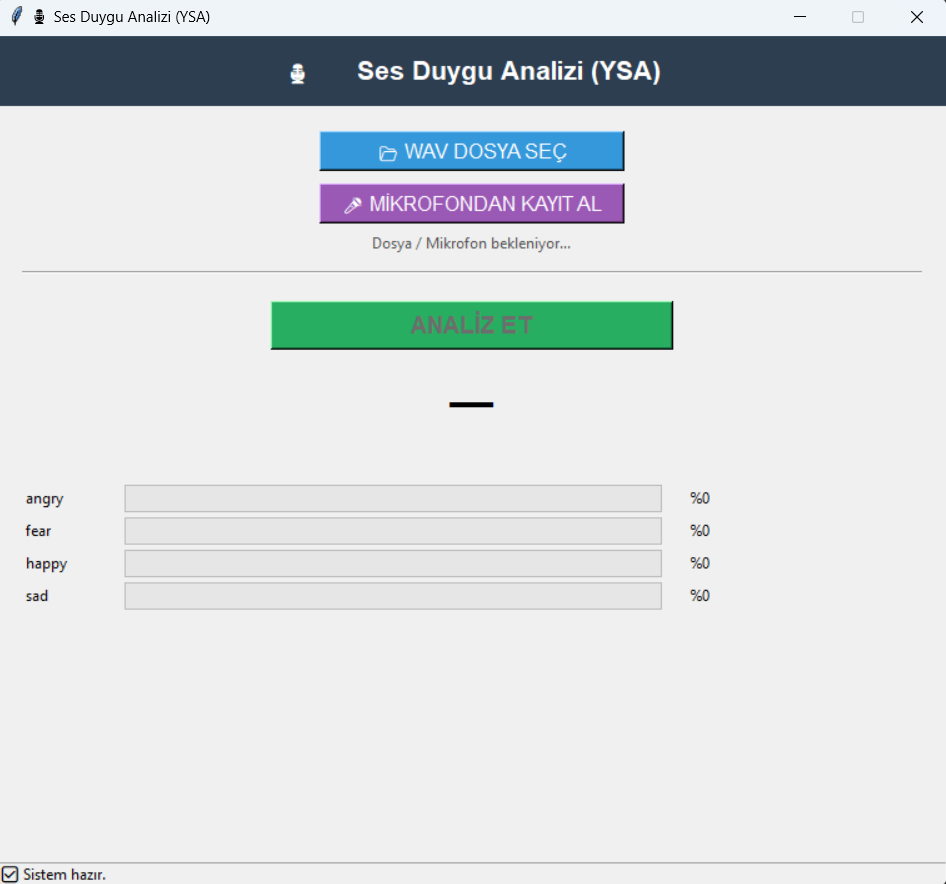

# Ses Duygu Analizi

Bu proje, konuşma seslerinden dört temel duyguyu sınıflandırmak amacıyla geliştirilmiş makine öğrenmesi ve yapay sinir ağı tabanlı bir ses duygu analizi sistemidir.

Sistem, farklı ses veri setlerinden elde edilen kayıtları işleyerek ses özniteliklerini çıkarır ve çeşitli sınıflandırma modelleriyle duygu tahmini gerçekleştirir.

## Desteklenen Duygular

- Happy (Mutlu)
- Sad (Üzgün)
- Angry (Öfkeli)
- Fear (Korkmuş)

## Kullanılan Veri Setleri

- RAVDESS
- TESS
- SAVEE
- CREMA-D
- BNC (Kendi ses kayıtları)

Veri setlerinin orijinal dosyaları bu GitHub deposuna dahil edilmemiştir. Kullanıcıların veri setlerini ilgili kaynaklardan edinmesi gerekir.

## Proje İş Akışı

1. Ses verilerinin taranması ve etiketlenmesi
2. Ses kayıtlarının ön işlenmesi
3. Veri artırma işlemleri
4. Ses özniteliklerinin çıkarılması
5. Klasik makine öğrenmesi modellerinin eğitilmesi
6. Yapay sinir ağı modelinin eğitilmesi
7. Model performanslarının değerlendirilmesi
8. İstatistiksel analizlerin gerçekleştirilmesi
9. Masaüstü arayüzü üzerinden tahmin yapılması

## Kullanılan Ses Öznitelikleri

Toplam 184 öznitelik kullanılmaktadır:

- 40 MFCC
- 12 Chroma
- 128 Mel Spectrogram
- RMS (ortalama ve standart sapma)
- Zero Crossing Rate (ortalama ve standart sapma)

Ses kayıtları 22050 Hz örnekleme hızında işlenmekte ve 2.5 saniyelik uzunluğa göre düzenlenmektedir.

## Kullanılan Modeller

### Klasik Makine Öğrenmesi

- Decision Tree
- Support Vector Machine (SVM)
- K-Nearest Neighbors (KNN)
- Logistic Regression
- Random Forest

### Ensemble Modeller

- Gradient Boosting
- Voting Classifier

### Yapay Sinir Ağı

Birden fazla Dense katman, Batch Normalization, ReLU aktivasyonu ve Dropout kullanılarak sınıflandırma modeli oluşturulmuştur.

Eğitim sırasında Early Stopping, ReduceLROnPlateau ve ModelCheckpoint yöntemlerinden yararlanılmıştır.

## Değerlendirme Yöntemleri

- Accuracy
- Precision
- Recall
- F1-Score
- Confusion Matrix
- 10-Fold Cross Validation
- McNemar Testi
- ROC-AUC Analizi

## Masaüstü Arayüzü

Proje, Tkinter tabanlı bir masaüstü arayüzüne sahiptir.

Arayüz üzerinden:
- WAV dosyası seçilebilir.
- Mikrofondan ses kaydı alınabilir.
- Ses kaydı analiz edilebilir.
- Tahmin edilen duygu ve sınıflara ait olasılıklar görüntülenebilir.

## Kurulum

Python ortamı oluşturduktan sonra bağımlılıkları yükleyin:

```bash
pip install -r requirements.txt
```

Veri setlerini `data` klasörüne yerleştirdikten sonra işlem sırası:

```bash
python 1_veri_hazirlama.py
python 2_oznitelik_cikarimi.py
python 3_modelleri_egit.py
python 4_ysa_modeli.py
python 5_kfold_dogrulama.py
python 6_istatistik_testleri.py
python 7_final_arayuz.py
```

Not: Arayüzün çalışması için önceden eğitilmiş model, scaler ve etiket dosyalarının `sonuclar_ysa` klasöründe bulunması gerekir.

## Kullanılan Teknolojiler

Python, NumPy, Pandas, Librosa, Scikit-learn, TensorFlow/Keras, Matplotlib, Seaborn, Joblib ve Tkinter.

## Not

Bu proje akademik çalışma ve uygulamalı makine öğrenmesi geliştirme amacıyla hazırlanmıştır. Model sonuçları kullanılan veri setlerine, eğitim koşullarına ve ses kayıtlarının özelliklerine göre değişebilir.

## Uygulama Arayüzü

### Ana Ekran


### Ses Duygu Analizi
