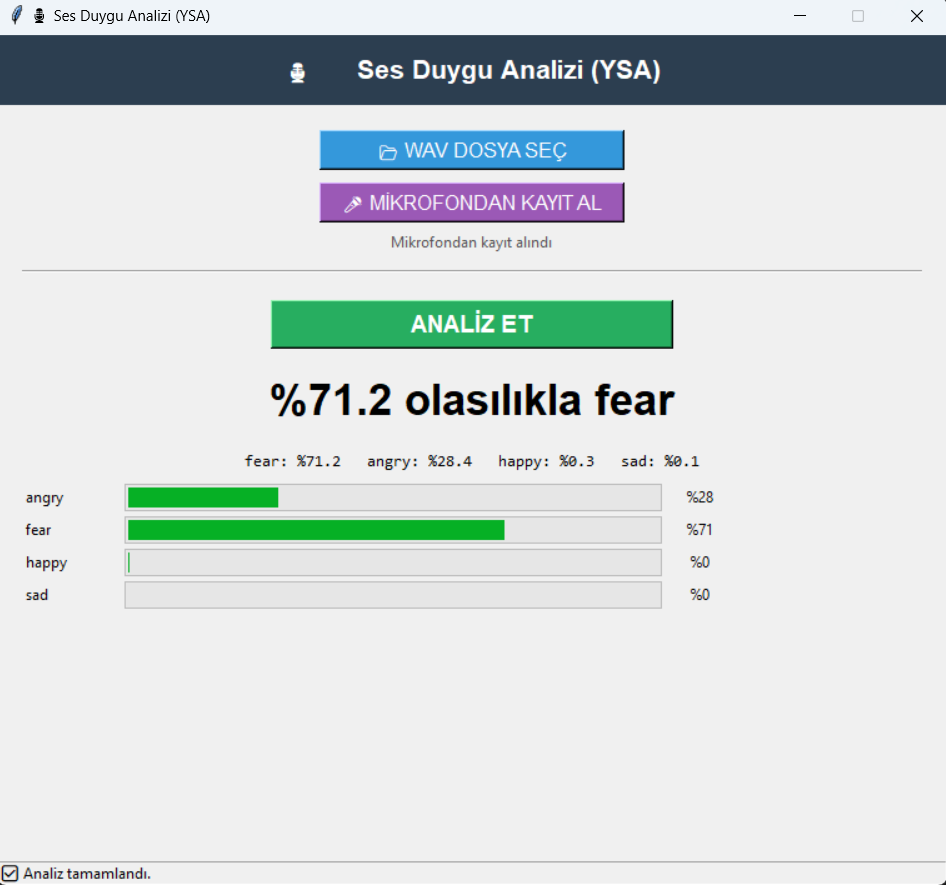

# 🎙️ Ses Duygu Analizi

Konuşma seslerinden dört temel duyguyu sınıflandırmak amacıyla geliştirilen makine öğrenmesi ve yapay sinir ağı tabanlı bir ses duygu analizi projesidir.

Sistem, farklı ses veri setlerinden elde edilen kayıtları işleyerek ses özniteliklerini çıkarır ve çeşitli sınıflandırma modelleriyle duygu tahmini gerçekleştirir. Ayrıca geliştirilen masaüstü arayüzü üzerinden WAV dosyaları veya mikrofon kaydı analiz edilebilir.

## 🧠 Desteklenen Duygular

| Duygu | İngilizce |
|---|---|
| 😊 Mutlu | Happy |
| 😢 Üzgün | Sad |
| 😠 Öfkeli | Angry |
| 😨 Korkmuş | Fear |

## 📂 Kullanılan Veri Setleri

- RAVDESS
- TESS
- SAVEE
- CREMA-D
- BNC (Kendi ses kayıtları)

Veri setlerinin orijinal dosyaları bu GitHub deposuna dahil edilmemiştir. Kullanıcıların veri setlerini ilgili kaynaklardan edinmesi gerekir.

## ⚙️ Proje İş Akışı

1. Ses verilerinin taranması ve etiketlenmesi
2. Ses kayıtlarının ön işlenmesi
3. Veri artırma işlemleri
4. Ses özniteliklerinin çıkarılması
5. Klasik makine öğrenmesi modellerinin eğitilmesi
6. Yapay sinir ağı modelinin eğitilmesi
7. Model performanslarının değerlendirilmesi
8. İstatistiksel analizlerin gerçekleştirilmesi
9. Masaüstü arayüzü üzerinden tahmin yapılması

## 🎵 Kullanılan Ses Öznitelikleri

Toplam 184 öznitelik kullanılmaktadır:

| Öznitelik | Sayı |
|---|---:|
| MFCC | 40 |
| Chroma | 12 |
| Mel Spectrogram | 128 |
| RMS (ortalama ve standart sapma) | 2 |
| Zero Crossing Rate (ortalama ve standart sapma) | 2 |
| **Toplam** | **184** |

Ses kayıtları 22050 Hz örnekleme hızında işlenmekte ve 2.5 saniyelik uzunluğa göre düzenlenmektedir.

## 🤖 Kullanılan Modeller

### Klasik Makine Öğrenmesi

- Decision Tree
- Support Vector Machine (SVM)
- K-Nearest Neighbors (KNN)
- Logistic Regression
- Random Forest
- Gradient Boosting

### Ensemble Model

- Voting Classifier

### Yapay Sinir Ağı (YSA)

Birden fazla Dense katman, Batch Normalization, ReLU aktivasyonu ve Dropout kullanılarak sınıflandırma modeli oluşturulmuştur.

Eğitim sürecinde Early Stopping ve ModelCheckpoint yöntemlerinden yararlanılmıştır.

## 📊 Model Performansları

### Klasik Modeller – Test Sonuçları

Modeller, %80 eğitim ve %20 test ayrımı kullanılarak değerlendirilmiştir.

| Model | Accuracy | F1-Score |
|---|---:|---:|
| **Random Forest** | **%87.10** | **%87.01** |
| Voting Classifier | %80.93 | %80.79 |
| SVM | %78.98 | %78.87 |
| KNN | %78.30 | %78.31 |
| Decision Tree | %77.53 | %77.52 |
| Gradient Boosting | %73.85 | %73.65 |
| Logistic Regression | %66.35 | %66.14 |

### 10-Fold Cross Validation

Modeller ayrıca Stratified 10-Fold Cross Validation yöntemiyle değerlendirilmiştir.

| Model | Ortalama Accuracy | Standart Sapma |
|---|---:|---:|
| **Random Forest** | **%87.99** | ±0.52 |
| Voting Classifier | %81.37 | ±0.50 |
| SVM | %79.41 | ±0.61 |
| Decision Tree | %79.36 | ±1.05 |
| KNN | %74.74 | ±0.83 |
| Gradient Boosting | %74.51 | ±0.46 |
| Logistic Regression | %65.67 | ±0.74 |

### YSA ve Random Forest Karşılaştırması

YSA ve Random Forest modelleri aynı eğitim/test ayrımı kullanılarak ayrıca karşılaştırılmıştır. Bu deneyde veri %70 eğitim, %15 doğrulama ve %15 test olarak ayrılmıştır.

| Model | Test Accuracy |
|---|---:|
| **Random Forest** | **%84.91** |
| YSA | %81.00 |

Modellerin tahminleri McNemar testi ile karşılaştırılmış ve iki model arasındaki performans farkının istatistiksel olarak anlamlı olduğu görülmüştür (p < 0.05).

YSA modeli için ayrıca sınıf bazlı ROC-AUC analizi gerçekleştirilmiştir.

## 📈 Değerlendirme Yöntemleri

- Accuracy
- Precision
- Recall
- F1-Score
- Confusion Matrix
- Stratified 10-Fold Cross Validation
- McNemar Testi
- ROC-AUC Analizi

## 🖥️ Masaüstü Arayüzü

Proje, Tkinter tabanlı bir masaüstü arayüzüne sahiptir.

Arayüz üzerinden:

- WAV dosyası seçilebilir.
- Mikrofondan ses kaydı alınabilir.
- Ses kaydı analiz edilebilir.
- Tahmin edilen duygu ve sınıflara ait olasılıklar görüntülenebilir.

### Uygulama Ekran Görüntüleri

**Ana Ekran**


**Ses Duygu Analizi**



## 💻 Kurulum

Projeyi bilgisayarınıza klonlayın:

```bash
git clone https://github.com/busranurcelik/ses-duygu-tanima.git
cd ses-duygu-tanima
```

Bağımlılıkları yükleyin:

```bash
pip install -r requirements.txt
```

Veri setlerini `data` klasörüne yerleştirdikten sonra aşağıdaki işlem sırası izlenebilir:

```bash
python 1_veri_hazirlama.py
python 2_oznitelik_cikarimi.py
python 3_modelleri_egit.py
python 4_ysa_modeli.py
python 5_kfold_dogrulama.py
python 6_istatistik_testleri.py
python 7_final_arayuz.py
```

Yalnızca eğitilmiş model üzerinden arayüzü çalıştırmak için:

```bash
python 7_final_arayuz.py
```

**Not:** Arayüzün çalışması için önceden eğitilmiş model, scaler ve etiket dosyalarının `sonuclar_ysa` klasöründe bulunması gerekir.

## 🛠️ Kullanılan Teknolojiler

- Python
- NumPy
- Pandas
- Librosa
- Scikit-learn
- TensorFlow / Keras
- Matplotlib
- Seaborn
- Joblib
- Tkinter

## 📌 Proje Hakkında

Bu proje akademik çalışma ve uygulamalı makine öğrenmesi geliştirme amacıyla hazırlanmıştır. Model sonuçları kullanılan veri setlerine, eğitim koşullarına ve ses kayıtlarının özelliklerine göre değişebilir.