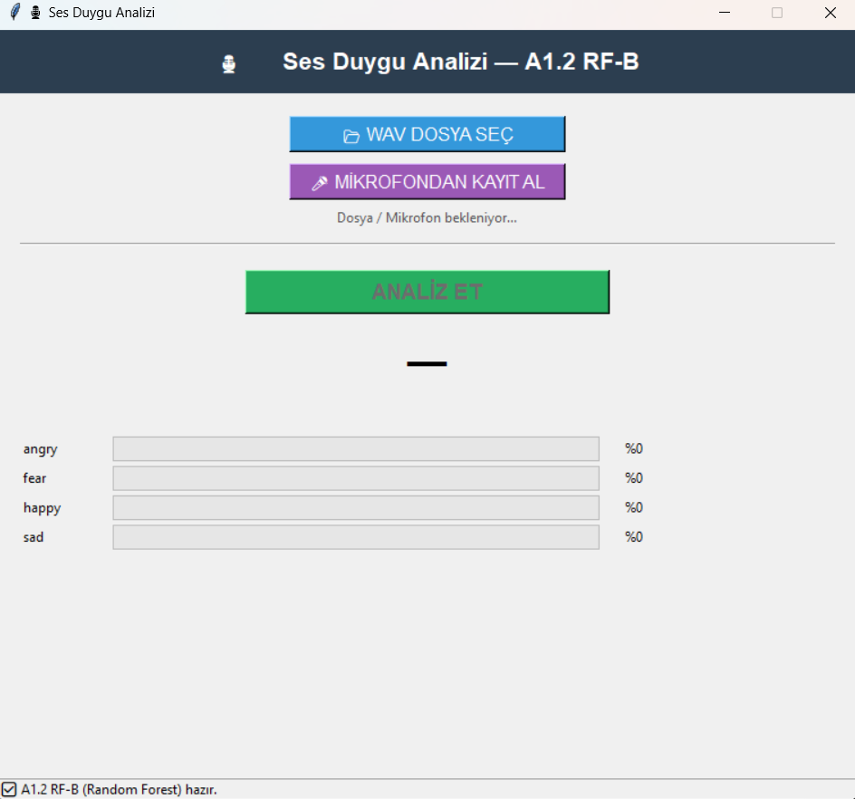
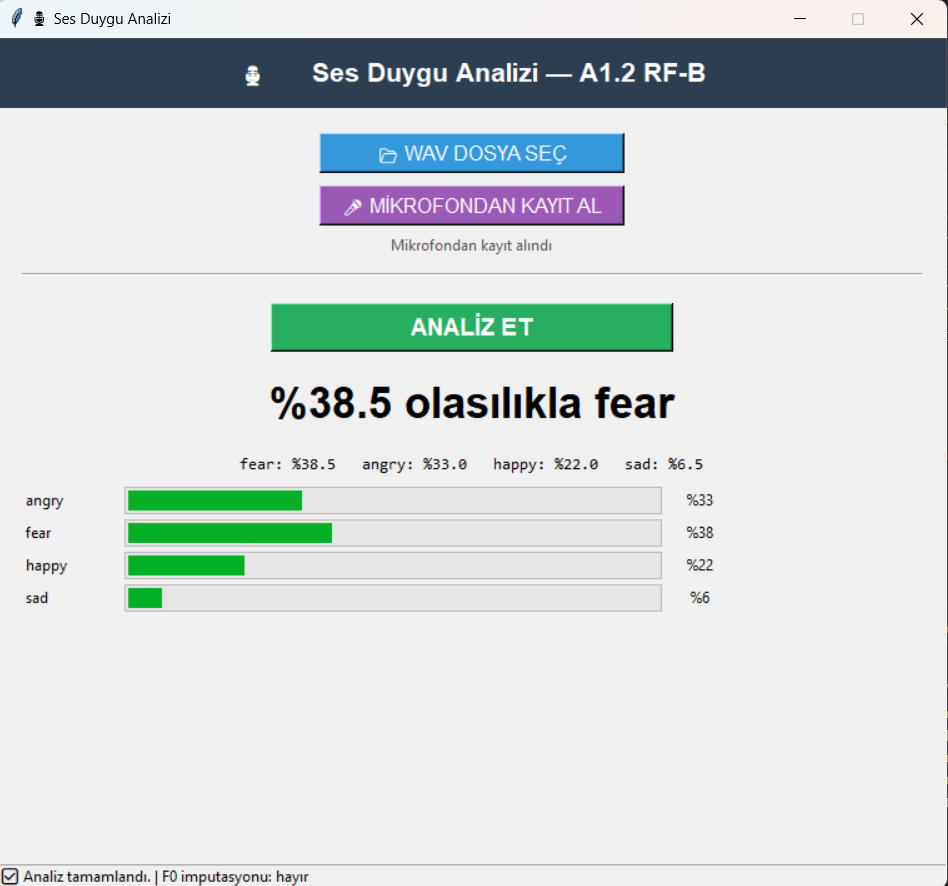

# Speech Emotion Recognition (SER)

## Project Overview

This repository documents a speech emotion recognition workflow for four emotions: `angry`, `fear`, `happy`, and `sad`. It contains the original feature-extraction, training, validation, GUI and audit code, together with aggregate evaluation reports. Raw audio, trained model weights, scaler artifacts and record-level derivatives are **not** included.

The primary model is **A1.2 RF-B**. An MLP with the same 192-feature input is documented only as an alternative candidate; it is not integrated into the GUI.

## Current System

### Acoustic features

A1.2 uses **192 ordered features**:

| Block | Features | Count |
|---|---|---:|
| MFCC | mean of 40 MFCC coefficients | 40 |
| Chroma | mean of 12 chroma-STFT bands | 12 |
| Mel | mean of 128 mel-scaled spectrogram bands | 128 |
| Energy / rhythm | RMS mean, RMS std, ZCR mean, ZCR std | 4 |
| F0 / pitch | mean, median, std, min, max, range, slope, voiced-frame ratio | 8 |
| **Total** |  | **192** |

F0 is extracted with **librosa pYIN** using `fmin=60`, `fmax=400`, `frame_length=2048`, `hop_length=512`, and a minimum of 3 valid voiced frames. When fewer than 3 voiced frames are available, the first seven F0 fields are replaced with training-only medians. `voiced_frame_ratio` is not imputed.

### Audio preprocessing

Audio is loaded with `librosa.load(..., sr=22050)`, normalized, and cropped or zero-padded to **2.5 seconds** (55,125 samples), matching the training pipeline.

### GUI

`7_final_arayuz.py` is a Tkinter application that accepts a WAV file or a microphone recording. It loads local A1.2 artifacts through `arayuz_A1_2_adapter.py`, produces 192 features, applies the matching scaler, and displays the raw `predict_proba` output. There is no post-hoc happy-bias correction or threshold adjustment. If a required artifact is missing, analysis is disabled and an explicit error is shown.

The GUI and adapter are original project code and are MIT-licensed. The artifacts they expect are local-only and are **not** distributed by this repository.

## Application Screenshots

### Application Interface



### Emotion Prediction Example



## Model Performance

### Protocols

The two reported evaluations use different protocols and are not directly comparable:

- **10-fold group-aware OOF:** 7,780 canonical original recordings after `REVIEW_LABEL` exclusions. Augmentation is used only inside training folds; each fold is evaluated on original (`orig`) recordings only. Scaler and F0 imputation medians are learned separately from that fold's training data. No final model is saved by this protocol.
- **70/15/15 holdout:** group-aware split with 17,536 training rows, 1,268 validation rows and **800 original test recordings** (200 per class). Augmentation, scaling and F0 imputation are fitted on the training partition only. The final RF-B artifact is produced by this protocol.

The 70/15/15 test set consists entirely of the **TESS_YAF speaker**. It measures performance on one unseen speaker, not speaker-independent generalization. An independent external test was not possible: the selection/license/overlap audit found no unused, hash-clean recordings that could supply 15 examples per class per source. No external accuracy metric was produced.

### 10-fold group-aware OOF (n = 7,780)

| Model | Accuracy | Macro-F1 | Angry F1 | Fear F1 | Happy F1 | Sad F1 | Fear→Happy | Happy→Fear |
|---|---:|---:|---:|---:|---:|---:|---:|---:|
| RF | **59.78%** | **59.22%** | **63.44%** | 46.45% | **54.97%** | **72.00%** | 402 | 220 |
| MLP | 59.50% | 59.12% | 62.77% | **48.48%** | 54.21% | 71.03% | 458 | 225 |

RF's OOF lead is marginal: +0.28 percentage points accuracy and +0.09 macro-F1. No paired significance test was run for this comparison.

### 70/15/15 holdout test (n = 800, TESS_YAF only)

| Model | Accuracy | Macro-F1 | Angry F1 | Fear F1 | Happy F1 | Sad F1 | Fear→Happy | Happy→Fear |
|---|---:|---:|---:|---:|---:|---:|---:|---:|
| **RF-B** | **65.63%** | **62.52%** | 68.50% | **41.25%** | **40.33%** | **100.00%** | **88** | **4** |
| MLP | 60.75% | 55.48% | **74.86%** | 33.73% | 26.56% | 86.77% | 120 | 6 |

RF-B is the primary candidate because it is ahead on this held-out test and slightly ahead on OOF. Its training accuracy is 100.00% versus 60.96% on validation, indicating a substantial train/validation gap. The MLP remains an alternative; RF-B is not presented as universally superior.

## Methodology

- **Data preparation and labels:** recordings from CREMA-D, RAVDESS, SAVEE, TESS and a locally recorded BNC set were mapped to the four target emotions. The deduplicated draft contained 7,782 records; 2 `REVIEW_LABEL` records (one SHA-256 group) were removed. A separate 17-record `REVIEW_QC` set had zero overlap with the draft. The canonical set contains **7,780 recordings**, 7,780 unique `source_id` values, 7,780 unique SHA-256 hashes and 122 speaker/group IDs.
- **Deduplication:** canonical records are unique by content hash and `source_id`. No `source_id` appears in more than one split or CV fold.
- **Group-aware separation:** `GroupShuffleSplit` is used for the 80/20 and 70/15/15 splits and `StratifiedGroupKFold(n_splits=10)` for cross-validation.
- **Train-only augmentation:** variants are generated only for recordings assigned to training in the relevant protocol. Validation and test rows always use the original (`orig`) signal.
- **Train-only imputation and scaling:** the `StandardScaler` is fitted only on training rows; F0 imputation medians are computed only from training rows without fallback.
- **Leakage checks:** the 70/15/15 run reports **42/42 PASS** checks; the 10-fold OOF protocol reports zero train/test group and source overlap and one prediction per canonical record.

Raw audio and record-level manifest/feature tables are not part of this repository. Only aggregate reports are included.

## Installation

Use **Python 3.13.5**, the version used in the development environment. Run the commands below from the project root (the directory containing `requirements.txt`, `requirements-gui.txt` and `7_final_arayuz.py`).

### Full project

```bash
python -m pip install -r requirements.txt
```

This pins joblib, librosa, matplotlib, numpy, pandas, scikit-learn, scipy, seaborn, sounddevice and TensorFlow. TensorFlow is needed only by the MLP training and cross-validation modules; it is not needed by the RF-B GUI.

### GUI and RF-B inference only

```bash
python -m pip install -r requirements-gui.txt
```

This smaller set omits TensorFlow, pandas, matplotlib and seaborn because neither the GUI nor the RF-B adapter imports them.

### Running the GUI

```bash
python 7_final_arayuz.py
```

Microphone recording requires a working audio input device.

### Local-only artifacts required by the GUI

The adapter expects these four files at these paths relative to the project root. **They are not included in this repository** and must be produced locally from licensed data:

```text
A1_2/70_15_15/modeller/rf_70_15_15_matched_A1_2.joblib
A1_2/70_15_15/modeller/scaler_A1_2.joblib
A1_2/70_15_15/f0_imputasyon_degerleri.csv
A1_2/70_15_15/ysa/70_15_15_label_map_A1_2.json
```

The `ysa/` name is historical; in this chain it holds a label-map JSON, not a Keras model. `mlp_best_70_15_15_A1_2.keras` is an alternative artifact and is not loaded by the GUI. No download links are provided for model weights, raw WAVs or large generated feature CSVs.

## Released Project Structure

Only reviewed files are part of the release. The structure below reflects the current release candidate; local-only and excluded items are listed separately.

```text
.
├── LICENSE                         # MIT, code only
├── LICENSES.md
├── ATIF.md
├── MODEL_LICENSE_REVIEW.md
├── README.md
├── requirements.txt
├── requirements-gui.txt
├── .gitignore
├── 1_veri_hazirlama.py
├── 1_veri_hazirlama_v2.py
├── 2_oznitelik_cikarimi.py
├── 2_oznitelik_cikarimi_v2.py
├── 2_oznitelik_cikarimi_v2_dedup.py
├── 3_modelleri_egit.py
├── 3_modelleri_egit_v2.py
├── 4_ysa_modeli.py
├── 4_ysa_modeli_v2.py
├── 5_kfold_dogrulama.py
├── 5_kfold_dogrulama_v2.py
├── 6_istatistik_testleri.py
├── 6_istatistik_testleri_v2.py
├── 7_final_arayuz.py
├── arayuz_A1_2_adapter.py
├── scaler_kaydet.py
├── test_arayuz_A1_2.py
├── A1_2_RF_B_GUI_entegrasyon_raporu.md
├── github_son_yayin_dosyasi_listesi.md
├── model_agirliklari_lisans_incelemesi.md
├── model_secimi_paketleme_oncesi_inceleme.md
└── A1_2/
    ├── ozellik_cikarimi_A1_2.py
    ├── ozellik_cikarimi_raporu.md
    ├── on_kontrol_A1_2.py
    ├── A0_karsilastirma_A1_2.csv
    ├── augmentation_dagilim.csv
    ├── f0_augmentasyon_kontrolu.csv
    ├── f0_dagilim_raporu.md
    ├── f0_kalite_kontrol.csv
    ├── f0_ozellik_tanimlari.csv
    ├── f0_sinif_kaynak_istatistikleri.csv
    ├── fold_sayilari.csv
    ├── kaynak_sayilari.csv
    ├── leakage_kontrolleri.csv
    ├── on_kontrol_A1_2.csv
    ├── on_kontrol_A1_2.md
    ├── sha256_source_id_kontrolleri.csv
    ├── sinif_sayilari.csv
    ├── split_sayilari.csv
    ├── veri_hazirlama_raporu.md
    ├── 70_15_15/
    │   ├── 4_ysa_A1_2.py
    │   ├── son_rapor.md
    │   ├── dogrulama_kontrolleri.csv
    │   ├── dogrulama_kontrolleri.md
    │   ├── f0_imputasyon_degerleri.csv
    │   ├── filtre_dogrulama.csv
    │   ├── karsilastirma/
    │   │   ├── A0_vs_A1_2_karisiklik.csv
    │   │   ├── A0_vs_A1_2_sinif_metrikleri.csv
    │   │   └── A0_vs_A1_2_test_metrikleri.csv
    │   └── ysa/
    │       ├── 70_15_15_accuracy_A1_2.png
    │       ├── 70_15_15_confusion_matrix_A1_2.csv
    │       ├── 70_15_15_egitim_val_farki_A1_2.csv
    │       ├── 70_15_15_karsilastirma_metrikleri_A1_2.csv
    │       ├── 70_15_15_label_map_A1_2.json
    │       ├── 70_15_15_loss_A1_2.png
    │       ├── 70_15_15_mlp_cm_A1_2.png
    │       ├── 70_15_15_rf_matched_cm_A1_2.png
    │       ├── 70_15_15_sinif_metrikleri_A1_2.csv
    │       └── 70_15_15_train_val_test_metrikleri_A1_2.csv
    ├── kfold/
    │   ├── 5_kfold_A1_2.py
    │   ├── dogrulama_sonrasi_A1_2.py
    │   ├── istatistiksel_karsilastirma_A1_2.py
    │   ├── cv_config.json
    │   ├── dogrulama_sonrasi.csv
    │   ├── dogrulama_sonrasi.md
    │   ├── f0_imputasyon_degerleri.csv
    │   ├── istatistik_bootstrap_farklari.csv
    │   ├── istatistik_genel.csv
    │   ├── istatistik_konfig.json
    │   ├── istatistik_mcnemar.csv
    │   ├── istatistik_sinif_f1.csv
    │   ├── karsilastirma_A0_A1_2.csv
    │   ├── karsilastirma_A0_A1_2.md
    │   ├── kfold_ozet.csv
    │   ├── kfold_per_fold.csv
    │   ├── oof_cm_MLP.png
    │   ├── oof_cm_RF.png
    │   ├── oof_karisiklik.csv
    │   ├── oof_kaynak_bazli.csv
    │   ├── oof_metrikler.csv
    │   ├── oof_sinif_f1.csv
    │   ├── sizdirma_kontrolleri.csv
    │   ├── sizdirma_kontrolleri.md
    │   └── son_rapor_A1_2.md
    └── dis_gercek_ses_testi/
        ├── 00_secim_ve_cakismalar.py
        ├── cakisma_ve_dogrulama_raporu.md
        └── lisans_durumu.csv
```

### Not part of the release

The following are **not** published in this repository:

- raw WAV datasets, record-level manifests, feature CSVs, temporary audio and local virtual environments;
- trained RF-B/MLP weights, scaler files and model manifests;
- old experiment trees such as `A1_1/`, `A3/`, `sonuclar_v2/` and `sonuclar_v2_dedup/`;
- `sonuclar_klasik/`, `sonuclar_istatistik/` and legacy `sonuclar_ysa/` outputs, whose publication status was not approved.

The 26 legacy outputs from the clean-base tree are excluded from this release; only aggregate A1.2 results are published.

## Limitations

- **Fear/happy confusion remains unresolved.** In OOF, RF produces 402 fear→happy errors; on the TESS_YAF test set it produces 88 fear→happy errors out of 200 fear examples (44%).
- **Performance varies strongly by source.** RF OOF accuracy ranges from 36.00% on the locally recorded BNC set to 67.56% on TESS. The 70/15/15 test contains only TESS_YAF, so no speaker-independent or cross-source generalization claim is supported.
- **No independent external test was completed.** The audit is documented in `A1_2/dis_gercek_ses_testi/cakisma_ve_dogrulama_raporu.md`.
- **RF-B shows a large train/validation gap** (100.00% training vs 60.96% validation). Its OOF lead over the MLP is very small.
- **SAVEE licensing could not be verified** (`DOGRULANAMADI`); no authoritative license or consent text was found.
- **BNC publication consent is not documented.** The 100 local recordings come from a single speaker (`BNC_SPEAKER_01`) and must not be publicly distributed.
- **Model weights and scalers are not distributed.** Their redistribution status remains `LICENSE_REVIEW`.

## License and Dataset Attribution

- **Code:** only the 24 original Python source files listed in `LICENSES.md` are MIT-licensed under `LICENSE`. Third-party packages, datasets, model weights, scaler files, raw audio, record-level derivatives, screenshots and aggregate reports are **not** covered by MIT.
- **Datasets:** see `ATIF.md`. CREMA-D is ODbL 1.0 / DbCL 1.0; RAVDESS is CC BY-NC-SA 4.0; TESS is CC BY-NC 4.0; SAVEE is `DOGRULANAMADI`; BNC publication consent is not documented.
- **Models and scaler:** see `MODEL_LICENSE_REVIEW.md`. RF-B, MLP and scaler are `LICENSE_REVIEW`; no distribution permission is granted.
- **Full inventory:** see `LICENSES.md`; publication decisions are recorded in `github_son_yayin_dosyasi_listesi.md`.

Downloading a dataset is not redistribution permission. No raw data, model weights or scaler files are provided here. unresolved-rights files remain local and are excluded from publication.
